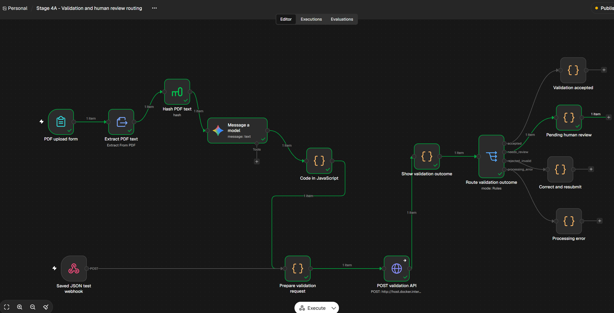
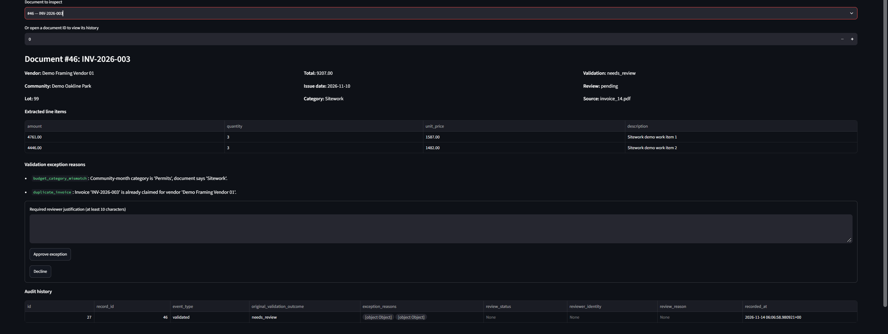
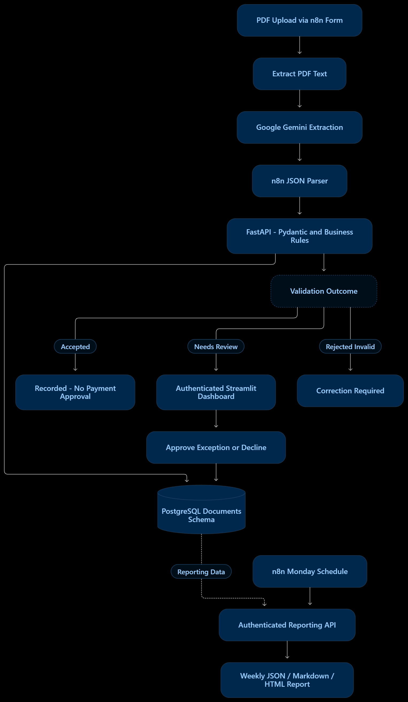

# 🏗️ Homebuilder AI Document Workflow

**AI-Powered Invoice Processing | Intelligent Workflow Automation | Human-in-the-Loop Review**

An end-to-end AI document automation system built with **Google Gemini, n8n, Python, FastAPI, PostgreSQL, and Streamlit**.

The system automatically extracts structured information from construction invoices and change orders, validates financial and business rules, identifies exceptions, routes flagged invoices to authenticated human reviewers, and generates weekly operational reports.

**Key engineering highlights**
- **46 passing automated tests**, including concurrency, authentication, reporting, and database validation.
- **Five n8n workflow exports**, covering document ingestion through weekly reporting.
- **16/16 extracted fields matched** on the first evaluated Gemini invoice; the remaining 19 documents have not been evaluated with saved live model outputs.
- **Concurrency-safe and auditable processing**, with idempotent submissions and immutable reviewer decisions.

All business records are fictional. Validation acceptance and human exception approval do not authorize payment.

**Technologies:** Python · Google Gemini · n8n · FastAPI · PostgreSQL · Pydantic · Streamlit · Docker · pytest

## Project Demonstration

### 1. AI Invoice Processing

### 2. Human-in-the-Loop Review

### 3. Automated Weekly Reporting

## Architecture

The system separates AI-powered document extraction from deterministic business validation, secure human review, and automated reporting.

- **n8n:** Orchestrates PDF uploads, text extraction, Gemini requests, validation routing, and scheduled reporting.
- **Google Gemini:** Extracts structured fields from invoices and change orders.
- **FastAPI + Pydantic:** Validates extracted information, checks business rules, and manages processing outcomes.
- **PostgreSQL:** Stores document records, validation outcomes, review decisions, and immutable audit history.
- **Streamlit:** Provides an authenticated interface for reviewing flagged invoices.
- **Weekly Reporting:** Generates operational summaries from verified database records.

**Security:** Validation acceptance and human exception approval never authorize payment.

[View detailed architecture](docs/architecture.md)
