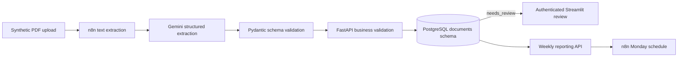
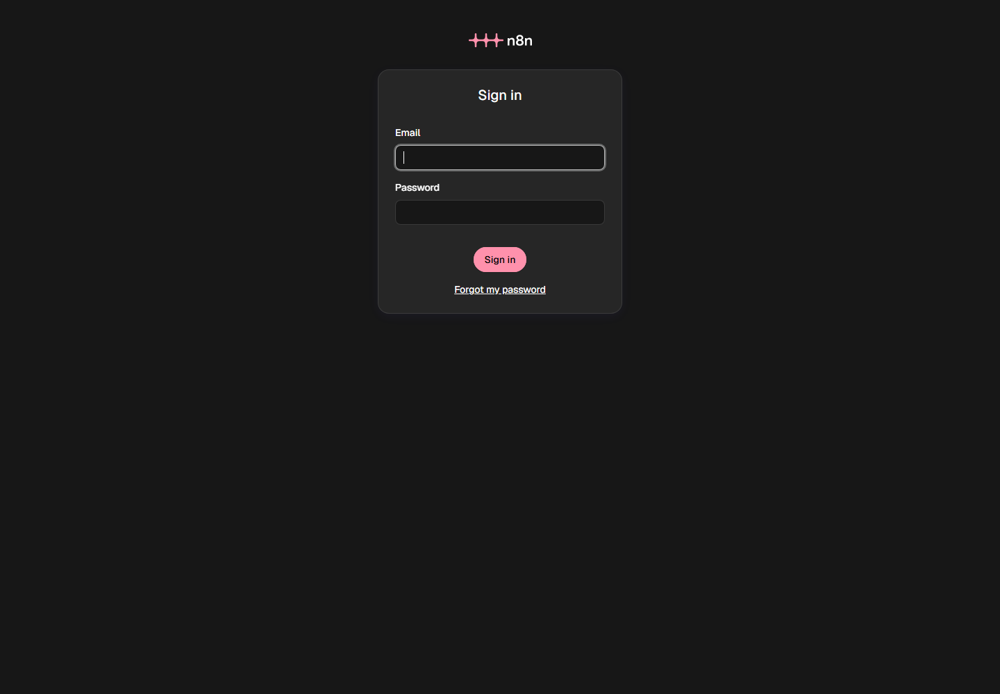

# Homebuilder AI Document Workflow

An end-to-end AI-assisted document operations portfolio project for a fictional residential homebuilder. The system ingests synthetic invoice and change-order PDFs, uses Google Gemini for structured extraction, applies deterministic business rules, stores traceable decisions in PostgreSQL, routes exceptions to an authenticated reviewer, and produces weekly operational reports with n8n.

No real employer, customer, vendor, or payment data is used. Validation acceptance and exception approval are explicitly **not payment authorization**.

## Business problem

Construction operations teams receive invoices and change orders with inconsistent layouts. Manual re-keying creates errors, duplicate-payment risk, weak auditability, and slow exception handling. This project demonstrates a controlled AI workflow in which a model performs document interpretation while deterministic software owns validation, state transitions, idempotency, and audit history.

## Architecture



Gemini is used only to convert document text into structured fields. Pydantic, Python `Decimal`, PostgreSQL constraints, and explicit Python rules determine document validity and workflow state. See [the detailed architecture](docs/architecture.md).

## Technology stack

- Python, FastAPI, Pydantic, Decimal, pytest
- PostgreSQL with a separate `documents` schema and limited application role
- n8n 2.46.7, pinned and self-hosted with Docker Compose
- Google Gemini through an n8n credential
- Streamlit reviewer dashboard
- ReportLab synthetic PDFs and pypdf text verification

## Main features

- 15 deterministic fictional invoices and 5 fictional change orders with independent ground truth.
- Text-selectable PDF ingestion and Gemini JSON extraction.
- Strict schemas and line-item arithmetic using `Decimal`, never binary floats.
- Unknown-vendor, duplicate-invoice, community/lot, required-field, arithmetic, and budget validation.
- Outcomes: `accepted`, `needs_review`, and `rejected_invalid`.
- Separate review states: `pending`, `approved_exception`, and `declined`.
- Concurrency-safe idempotency, duplicate detection, and immutable audit events.
- Authenticated localhost reviewer UI and least-privilege reporting API.
- DST-safe weekly reporting in `America/Los_Angeles`.
- JSON, Markdown, and HTML reports with idempotent receipts.

## Verified evidence

The latest complete automated run on 2026-11-14 produced:

```text
46 passed, 0 failed, 1 dependency deprecation warning in 0.79s
```

The live Stage 4A test verified authenticated approve/decline, HTTP 401 without authentication, HTTP 409 on repeated decisions, one winner during concurrent decisions, invalid-document approval rejection, and immutable audit history.

The live Stage 4B test matched independent SQL. At the final run it reported 53 synthetic document records, 9 accepted, 35 needing review, 9 rejected invalid, and `$26,392.00` of validation-accepted invoice value. These counts include synthetic integration-test records and are not production performance metrics or payment totals.


The screenshot is actual output generated with a fixed `as_of` time for a reproducible completed week. The local n8n deployment also required authentication:



No populated Streamlit or n8n-editor screenshot was captured during the final audit, so none is represented as evidence. The [demo script](docs/demo_script.md) gives exact steps for capturing those screens locally without exposing credentials.

## Extraction accuracy

The repository contains 20 PDFs and 20 ground-truth records, but only one saved output is an observed Gemini result: `evals/outputs/invoice_01.json`.

| Type | Evaluated | Field accuracy | Exact documents |
| --- | ---: | ---: | ---: |
| Invoice | 1 | 16/16 (100%) | 1/1 (100%) |
| Change order | 0 | Not measured | Not measured |
| Overall observed sample | 1 | 16/16 (100%) | 1/1 (100%) |

The other 19 documents have no saved Gemini output and are unevaluated. Mocked fixtures and validation tests are not counted as Gemini accuracy evidence. See [the final evaluation](docs/final_evaluation.md).

Run the evaluator without making a model request:

```powershell
.\.venv\Scripts\python.exe -m evals.accuracy
```

For quota-conscious expansion, process one PDF at a time through Stage 2, save the parser output as `evals/outputs/<pdf-stem>.json`, inspect it, and rerun:

```powershell
.\.venv\Scripts\python.exe -m evals.accuracy evals\outputs\*.json --report evals\reports\all_saved_outputs.json
```

The evaluator is offline. Gemini is called only when you manually execute the n8n model node.

## Getting started

Prerequisites: Docker Desktop, Python 3.11+, and the existing fictional Homebuilder Ops PostgreSQL container/network used by this portfolio environment.

```powershell
py -3 -m venv .venv
.\.venv\Scripts\Activate.ps1
python -m pip install -r requirements.txt
Copy-Item .env.example .env
# Replace every placeholder in .env with a unique local value.
python -m data.generate_documents
docker compose up -d --build api review-ui n8n
python -m pytest -q
```

Local services:

- n8n: <http://localhost:5678>
- validation/review/report API: <http://localhost:8001>
- Streamlit review UI: <http://localhost:8502>

The Compose project does not create another PostgreSQL instance. It connects using the limited `homebuilder_docs` role and stores Project 2 data only in the separate `documents` schema.

## Gemini credential setup

1. Sign in to local n8n at <http://localhost:5678>.
2. Create a Google Gemini credential in n8n's encrypted credential store.
3. Import a workflow from [`workflows/`](workflows/).
4. Open **Message a model** and select the credential.
5. Never put the API key in `.env`, workflow JSON, screenshots, or Git history.

The repository contains no Gemini key, and Python tests make no Gemini requests. Live model use can consume quota and must be initiated manually.

## Validation and human review

The full intake form is <http://localhost:5678/form/stage4a-pdf-intake>. It extracts PDF text, invokes Gemini, validates the parsed document, and routes the outcome. Saved JSON can be tested without Gemini as documented in [Stage 4A](docs/stage4a_review.md).

`accepted` means deterministic validation passed; it does not approve payment. Only eligible `needs_review` records enter the reviewer queue. `rejected_invalid` records must be corrected and resubmitted. Reviewer identity comes from the authenticated session, and each decision creates an immutable audit event.

## Weekly reporting

The separate Stage 4B workflow runs Mondays at 9:00 AM `America/Los_Angeles` while n8n is running. Generate it immediately with:

```powershell
Invoke-RestMethod -Method Post -Uri http://localhost:5678/webhook/stage4b-weekly-report
```

Reports keep validation, review, and payment authorization separate. Change orders are not invoice spending, and reporting never updates Project 1 budget actuals. See [Stage 4B reporting](docs/stage4b_reporting.md).

## Repository map

```text
app/                 FastAPI, validation, review, reporting, Streamlit
data/                generator, 20 synthetic PDFs, ground truth
evals/               offline evaluator and saved outputs
workflows/           separate importable n8n exports
tests/               unit, API, workflow, and opt-in live checks
docs/                contracts, migrations, architecture, demo, evidence
```

## Synthetic data and security limitations

All document and business names are fictional. The project does not implement payment processing, automatic approval, Slack, email, or changes to Project 1 business records.

This remains a localhost portfolio MVP:

- n8n forms/webhooks have no public-edge protection. Keep ports local; add TLS, ingress authentication, rate limits, and upload limits before public deployment.
- Reviewer sessions are in memory; reporting uses a shared bearer token from environment variables.
- There is no enterprise identity provider, secrets manager, token rotation service, or centralized observability.
- Historical transport failures and every raw attempt were not persisted, so those report metrics are unavailable.
- n8n's SQLite volume contains encrypted credentials and execution state and must never be committed.

Detailed setup and contracts are in [`docs/`](docs/). This repository is for synthetic local demonstration only.
