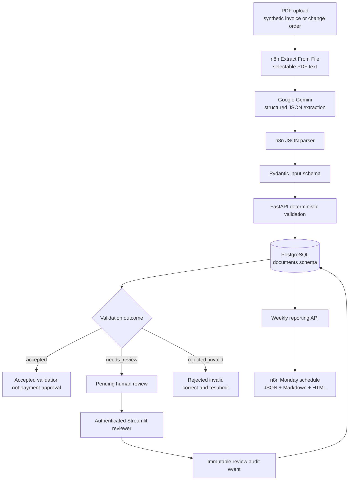

# Architecture

## System flow

## AI boundary

Gemini performs one bounded task: interpreting extracted document text and proposing structured fields such as vendor, document number, community, lot, line items, and total. The prompt tells the model to return JSON and not approve or reject documents. Model output is untrusted input.

The offline evaluator compares saved model output against independently generated ground truth. It validates document identity and line-item detail and never calls Gemini.

## Deterministic boundary

Python and PostgreSQL own all consequential behavior:

- Pydantic enforces request shape, required fields, dates, document types, and line items.
- `Decimal` validates quantities, prices, extensions, and totals.
- Rules check vendor identity, same-vendor duplicates, community/lot relationships, and budget policy.
- PostgreSQL uniqueness and transactions make retries idempotent and duplicate detection concurrency-safe.
- Validation outcomes and human-review decisions are separate state machines.
- Only `needs_review` invoices can receive decisions; invalid records must be corrected.
- Reviewer identity comes from the authenticated session, not request text.
- Audit events and report-run receipts are immutable.
- Reporting uses read-only aggregation and never changes Project 1 budget actuals.

Neither `accepted` nor `approved_exception` means payment is authorized.

## Data ownership

Project 1 remains the read-only source for fictional communities, lots, vendors, and budget categories. Project 2 writes only into the separate `documents` schema through a limited role. n8n keeps workflow state and encrypted credentials in its Docker volume, outside this repository.

## Reliability controls

- PDF-text hashes and idempotency keys preserve source identity across retries.
- Reusing a key with changed content returns HTTP 409.
- HTTP/transport failures route to processing errors, never approval.
- Atomic review decisions prevent concurrent double decisions.
- Weekly windows use aware Los Angeles boundaries with inclusive start and exclusive end.
- Report receipts are idempotent by key and period/source.

## Local trust boundary

Ports 5678, 8001, and 8502 bind to `127.0.0.1`. This is suitable for a local portfolio demo, not production. Public deployment would require TLS, edge authentication, rate limiting, network segmentation, managed secrets, persistent sessions, and monitoring.
