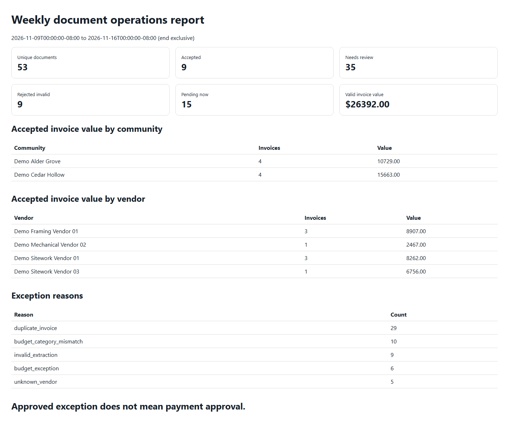
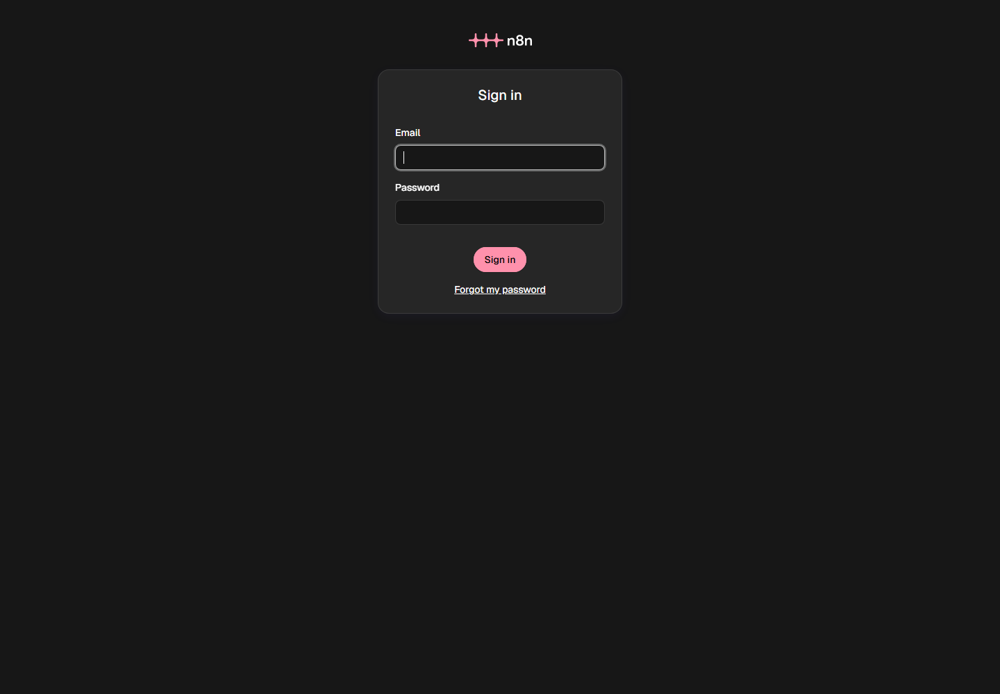

# Two-minute demo script

Use only fictional files. Start Docker Desktop and run `docker compose up -d --build api review-ui n8n`. Do not display `.env`, credential values, browser storage, or database connection strings while recording.

## 0:00–0:20 — Upload

1. Sign in at <http://localhost:5678>.
2. Open **Stage 4A - Validation and human review routing**.
3. Open <http://localhost:5678/form/stage4a-pdf-intake>.
4. Upload a file from [`data/samples/`](../data/samples/), such as [`invoice_01.pdf`](../data/samples/invoice_01.pdf).

Explain that ReportLab generated the text-selectable PDF and that independent truth lives in [`data/ground_truth/`](../data/ground_truth/).

## 0:20–0:45 — Extract

Open the n8n execution and show:

1. **Extract PDF text** — source text and filename.
2. **Message a model** — Gemini through an n8n credential; do not open the credential.
3. **Code in JavaScript** — parsed JSON, identity, line items, and decimal strings.

The saved observed evidence is [`invoice_01.json`](../evals/outputs/invoice_01.json): 16/16 fields and 1/1 exact document. Do not describe this as accuracy across 20 PDFs.

## 0:45–1:05 — Validate

Show **POST validation API** and **Show validation outcome**. Point out the stable filename/key, outcome, deterministic reasons, PostgreSQL record ID, and `approved_for_payment: false`.

To avoid another Gemini request, use the saved-JSON route in [`stage4a_review.md`](stage4a_review.md). Because duplicate state depends on earlier submissions, narrate the actual outcome rather than predicting one.

## 1:05–1:30 — Review

1. Sign in at <http://localhost:8502>.
2. Select an actual pending invoice.
3. Show its fields, lines, reasons, and audit history.
4. Enter a justification and approve the exception or decline it.
5. Show the new audit event and that payment remains unauthorized.

Repeated decisions correctly return HTTP 409. `rejected_invalid` records cannot be approved.

## 1:30–1:55 — Report

Run **Stage 4B - Weekly document reporting** manually, or call:

```powershell
Invoke-RestMethod -Method Post -Uri http://localhost:5678/webhook/stage4b-weekly-report
```

Show period boundaries, validation counts, pending-review snapshot, decisions, accepted-invoice value, breakdowns, and exception reasons. Approved exceptions are not payments; change orders are excluded from invoice value.

Actual checked-in report output:



Actual local n8n authentication screen:



## 1:55–2:00 — Close

Gemini interprets text; deterministic Python and PostgreSQL control validity, idempotency, review state, and auditability. Latest suite: 46 passed, 0 failed.

## Screenshot checklist

After signing in, optionally capture the Stage 4A workflow canvas, parsed synthetic JSON, Streamlit pending queue, and report. Inspect every image before publication. Do not show credential panels or browser storage.

No populated workflow-editor or reviewer-dashboard screenshot was available during the automated final audit. This guide does not substitute a fabricated mockup.
